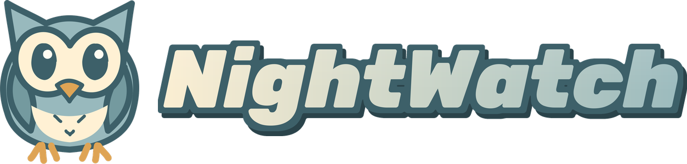

<p align="center"></p>

<h1 align="center">Don't Sleep, Keep Watch: Proactive Perception for Computer-Use Agents</h1>

<p align="center">
  <a href="#"></a>
  <a href="https://huggingface.co/nullptr04/NightWatch-0.8B"></a>
  <a href="https://huggingface.co/datasets/nullptr04/NightWatch-Data"></a>
  <a href="LICENSE"></a>
</p>

NightWatch is a plug-and-play harness that gives a computer-use agent (CUA) proactive perception. A lightweight
watcher, NightWatch-0.8B, looks at the screen as a stream and answers a fixed bank of generic questions. Deterministic
rules turn those answers into three interventions on an unmodified agent:

- **interrupt** its reasoning when a screen change makes it obsolete,
- **void** a pending action whose target has gone stale,
- **wake** the agent as soon as the screen settles, replacing the fixed post-action sleep.

The agent keeps its own model, prompt, and action space. Only its LLM call is made streaming and cancellable.

## Layout

| Path | Contents |
|---|---|
| `src/nightwatch/` | Harness: perception loop, frame stream, question bank, rules, agents, environments, analysis |
| `src/nightwatch/system1/` | Watcher backends (perception server, vLLM, hosted, simulated) |
| `training/` | Training data generation (synthetic web pages, desktop trajectories) and watcher training |
| `configs/` | Experiment configs; every config `extends: base` |
| `scripts/` | Environment setup, watcher servers, and run pipelines |
| `tests/` | Unit tests and a simulated end-to-end test |
| `third_party/OSWorld/` | OSWorld at a pinned upstream commit, with a small patch set |

## Setup

```bash
cp .env.example .env                       # then fill in the keys below
bash scripts/setup_env.sh                  # Python envs, pinned OSWorld / AOI checkouts, model weights, Chromium
MODELS=nightwatch bash scripts/setup_env.sh models   # the trained watcher, nullptr04/NightWatch-0.8B
python -m nightwatch doctor                # checks keys, OSWorld import, provider, watcher
```

**Agent (OpenRouter).** The experiments use MiMo-V2.6-Flash through [OpenRouter](https://openrouter.ai). Set
`OPENROUTER_API_KEY` in `.env`. The default `.env.example` already pins the serving provider
(`"allow_fallbacks": false`, so every method sees the same stack) and sets the request body of each benchmark:
`AGENT_EXTRA_BODY` for OSWorld (reasoning effort high) and `DYNACU_AGENT_EXTRA_BODY` for DynaCU-Bench. The DynaCU
judge is Gemini 2.5 Flash on OpenRouter with the same key. Any other OpenAI-compatible endpoint works through
`AGENT_BASE_URL`, `AGENT_MODEL` and `AGENT_API_KEY`.

**OSWorld sandbox.** OSWorld runs in Tencent Cloud Agent Sandbox (AGS, E2B-compatible), so no local docker or KVM
is needed and many environments run in parallel:

1. In the AGS console, create an API key and an OSWorld sandbox tool in a region close to this machine.
2. In `.env`, set `OSWORLD_PROVIDER=ags`, `E2B_API_KEY`, `E2B_DOMAIN` (`<region>.tencentags.com`) and
   `AGS_TEMPLATE` (the sandbox tool id), plus `AGS_SUDO_PASSWORD` for the template's guest user.
3. Run `bash scripts/setup_container.sh`. With `OSWORLD_PROVIDER=ags` it checks the keys, installs the e2b SDK and
   the AGS provider for OSWorld, and boots one sandbox to measure the screenshot rate.

Methods × workers must stay within the account's sandbox quota (the default is 4 × 6). A local docker VM also works:
`OSWORLD_PROVIDER=docker`, then `bash scripts/setup_container.sh` (needs docker access and `/dev/kvm`).

## Experiments

Both benchmarks compare Vanilla, AOI, PUSV and NightWatch on the same agent, prompt, action space and step budget.

```bash
bash scripts/serve_watcher.sh          # watcher servers for NightWatch (one GPU)

# OSWorld-Verified: 100 tasks x 3 (configs/osworld.yaml)
bash scripts/run_osworld.sh start      # one background run per method; status / retry / stop
bash scripts/run_osworld.sh metrics    # success, time breakdown, waste, interventions, cost

# DynaCU-Bench: 49 dynamic tasks x 3 (configs/dynacu.yaml), headless Chromium, no VM
bash scripts/run_dynacu.sh             # check, smoke, serve, main, metrics
STAGES="serve ablations" bash scripts/run_dynacu.sh   # ablations (configs/dynacu_ablations.yaml)
```

Any config value can be overridden with `python -m nightwatch run --config <name> --set a.b=value`. Each episode
writes `steps.jsonl` (per-step timestamps and time segments), `events.jsonl` (watcher answers and interventions)
and `result.json`. Offline pipeline check without keys, VM or GPU: `python -m nightwatch run --config smoke`.

## Model and data

- Watcher: [nullptr04/NightWatch-0.8B](https://huggingface.co/nullptr04/NightWatch-0.8B)
- Training data: [nullptr04/NightWatch-Data](https://huggingface.co/datasets/nullptr04/NightWatch-Data) (generated
  desktop tasks, SynthWeb, hindsight settledness; no benchmark tasks or files)

## Training the watcher

```bash
bash training/train_cua_jev.sh    # desktop data from generated training tasks + synthetic web data, SFT, eval
bash training/train.sh            # synthetic web data only: record -> build -> sft -> rl -> eval
```

Training uses only generated tasks and synthetic interfaces, never benchmark tasks, files, or trajectories.

## Tests

```bash
pytest -q
```

## License

Apache-2.0 (see `LICENSE`). `third_party/OSWorld` keeps its own Apache-2.0 license.
